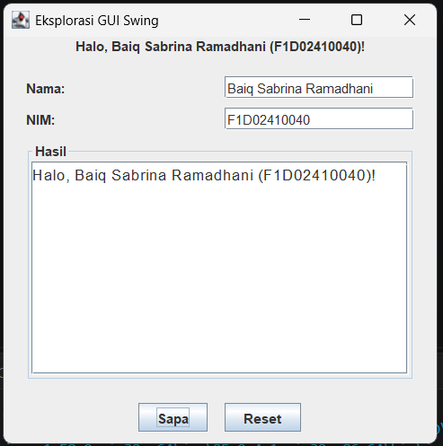
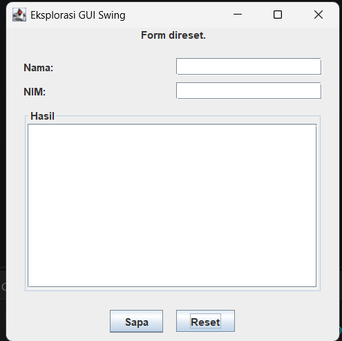

# Baiq Sabrina Ramadhani
# F1D02410040

Program GUI sederhana untuk latihan komponen GUI Java Swing. Pengguna mengisi **Nama** dan **NIM**, lalu klik **Sapa**. Hasil sapaan disimpan di kotak **Hasil**, dan tombol **Reset** mengosongkan form dan kotak Hasil.

## Tampilan Program






## Struktur File

| File | Peran |
|---|---|
| `Main.java` | Titik masuk program (`main`) |
| `MainFrame.java` | Jendela utama |
| `InputPanel.java` | Panel form Nama dan NIM |
| `ResultPanel.java` | Panel kotak Hasil |
| `ButtonPanel.java` | Panel tombol Sapa dan Reset |
| `AppButton.java` | Tombol buatan sendiri dengan efek hover |

## 5 Komponen Utama GUI

### 1. Top-level Container Class

Wadah paling luar yang berdiri sendiri sebagai jendela dan tidak bisa dimasukkan ke container lain.

| Class | Dipakai di | Keterangan |
|---|---|---|
| `javax.swing.JFrame` | `MainFrame` (`extends JFrame`) | Jendela utama aplikasi berjudul "Eksplorasi GUI Swing" |

### 2. Intermediate Container Class

Wadah perantara yang diletakkan di dalam top-level container untuk mengelompokkan komponen.

| Class | Dipakai di | Keterangan |
|---|---|---|
| `javax.swing.JPanel` | `InputPanel` | Mengelompokkan label dan field Nama dan NIM |
| `javax.swing.JPanel` | `ResultPanel` | Mengelompokkan kotak Hasil (dengan `TitledBorder`) |
| `javax.swing.JPanel` | `ButtonPanel` | Mengelompokkan tombol Sapa dan Reset |
| `javax.swing.JScrollPane` | `ResultPanel` | Pembungkus `JTextArea` agar bisa di-scroll |

### 3. Atomic Component Class

Komponen dasar yang tidak berfungsi sebagai wadah untuk komponen lain.

| Class | Dipakai di | Keterangan |
|---|---|---|
| `javax.swing.JLabel` | `MainFrame`, `InputPanel` | Teks label ("Nama:", "NIM:", status) |
| `javax.swing.JTextField` | `InputPanel` | Input teks satu baris untuk Nama dan NIM |
| `javax.swing.JTextArea` | `ResultPanel` | Area teks (read-only) untuk menyimpan hasil sapa |
| `javax.swing.JButton` | `AppButton` (`extends JButton`) | Tombol buatan sendiri yang dipakai untuk Sapa dan Reset |

### 4. Layout Classes

Pengatur posisi dan ukuran komponen di dalam container.

| Class | Dipakai di | Fungsi |
|---|---|---|
| `java.awt.BorderLayout` | `MainFrame` (dan panel `tengah`) | Membagi area NORTH, CENTER, SOUTH: label di atas, form dan Hasil di tengah, tombol di bawah |
| `java.awt.GridLayout` | `InputPanel` | Menyusun label dan field dalam grid 2 x 2 |
| `java.awt.FlowLayout` | `ButtonPanel` | Menyusun tombol berderet ke samping di tengah |

### 5. Event Listener (Override Method)

Penanganan aksi pengguna dengan meng-override method dari interface listener atau adapter class.

| Listener | Jenis | Method yang di-override | Dipakai di | Fungsi |
|---|---|---|---|---|
| `ActionListener` | Interface | `actionPerformed()` | `MainFrame` (tombol Sapa) | Memvalidasi input, menampilkan sapaan di label, dan menambah baris ke kotak Hasil |
| `ActionListener` | Interface | `actionPerformed()` | `MainFrame` (tombol Reset) | Mengosongkan form dan kotak Hasil |
| `MouseAdapter` | Adapter class | `mouseEntered()`, `mouseExited()` | `AppButton` | Tombol berubah hijau saat kursor di atasnya |
| `WindowAdapter` | Adapter class | `windowClosing()` | `MainFrame` | Menampilkan dialog konfirmasi sebelum keluar |

## Hierarki Komponen

```
MainFrame (JFrame, BorderLayout)
├── NORTH   : JLabel (status)
├── CENTER  : JPanel (BorderLayout)
│   ├── NORTH  : InputPanel (JPanel, GridLayout 2x2)
│   │             └── JLabel, JTextField (Nama, NIM)
│   └── CENTER : ResultPanel (JPanel, BorderLayout, border "Hasil")
│                 └── JScrollPane → JTextArea
└── SOUTH   : ButtonPanel (JPanel, FlowLayout)
              └── AppButton "Sapa", AppButton "Reset"
```

## Cara Menjalankan

Pastikan JDK sudah terpasang, lalu jalankan di folder yang berisi semua file `.java`:

```bash
javac *.java
java Main
```
